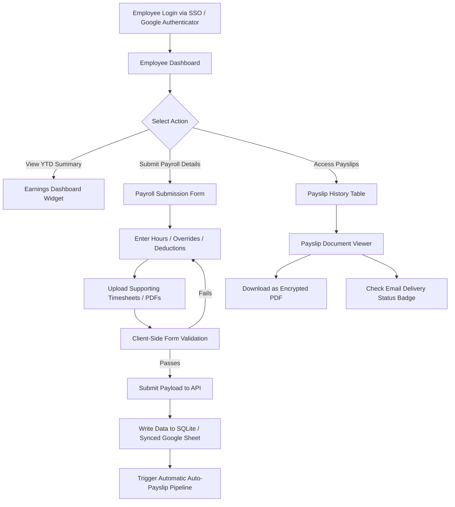
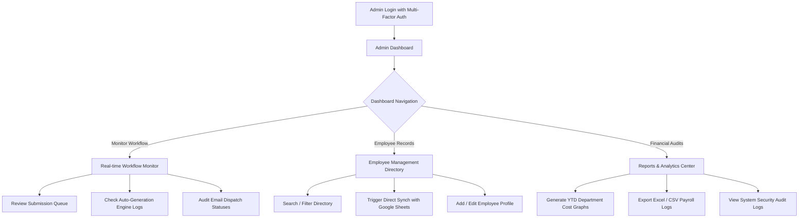

# Helport Payroll & Payslip Management System
## UI/UX Design System & Frontend Architecture Specification
**Version:** 1.0.0  
**Target:** Internal Company Use  
**Branding Reference:** [helport.ai](https://www.helport.ai/home)  
**Author:** Senior UI/UX Designer & Frontend Architect  

---

## Table of Contents
1. [Brand Identity & Design Philosophy](#1-brand-identity--design-philosophy)
2. [Branded Color Palette](#2-branded-color-palette)
3. [Typography Hierarchy](#3-typography-hierarchy)
4. [Design System Tokens (Grid, Spacing, Borders, Blurs)](#4-design-system-tokens-grid-spacing-borders-blurs)
5. [User Flow Diagrams (Mermaid.js)](#5-user-flow-diagrams-mermaidjs)
6. [Employee Portal Screen Specifications](#6-employee-portal-screen-specifications)
   - [Employee Dashboard](#employee-dashboard)
   - [Payroll Submission Form](#payroll-submission-form)
   - [Payslip Viewer](#payslip-viewer)
7. [Admin Portal Screen Specifications](#7-admin-portal-screen-specifications)
   - [Admin Dashboard](#admin-dashboard)
   - [Employee Management](#employee-management)
   - [Reports & Analytics](#reports--analytics)
8. [Mobile & Tablet Responsiveness](#8-mobile--tablet-responsiveness)
9. [Component Library (React & Tailwind CSS)](#9-component-library-react--tailwind-css)
10. [High-Fidelity UI Layout Mockups (ASCII)](#10-high-fidelity-ui-layout-mockups-ascii)
11. [Security, Performance & SEO Best Practices](#11-security-performance--seo-best-practices)

---

## 1. Brand Identity & Design Philosophy

Helport AI's branding focuses on its **"AI Labor System" (HyprX)** and **"AI Assist"** platforms, representing a combination of cutting-edge artificial intelligence, digital-twin expert replication, and robust enterprise utility. To reflect this on the internal **Payroll & Payslip Management System**, we utilize a design philosophy called **"Cyber-Secure Glassmorphism"**.

### Design Principles
*   **Trust through Aesthetics:** Deep, high-contrast dark backgrounds combined with glowing cyber-accents mimic the security of an encrypted banking terminal.
*   **Operational Transparency:** Layouts feature clean lines, strict grids, and real-time state synchronization badges, aligning with Helport's "single-pane-of-glass" monitoring philosophy.
*   **Frictionless Workflows:** Reduced input friction, clear step-by-step progress lines, and accessible download nodes ensure that employees and administrators can perform tasks quickly.
*   **Accessible Data Density:** Financial numbers must be highly legible. We leverage tabular monospace fonts paired with sans-serif headings to separate narrative labels from financial computations.

---

## 2. Branded Color Palette

Our palette is derived directly from the dark-mode theme of Helport AI's website. It uses a high-contrast dark base accented by cybernetic glows, alongside custom green, orange, and red indicators for system audits.

### A. Primary Dark Theme (Default)
| Palette Role | HEX Value | CSS Variable | Applied Use Cases |
| :--- | :--- | :--- | :--- |
| **Obsidian Base (Background)** | `#08090B` | `--background` | Main page body, shell container |
| **Glass Surface (Cards/Nav)** | `rgba(17, 19, 23, 0.7)` | `--card-bg` | Floating cards, sidebar panels |
| **Helport Glow (Primary)** | `#00D2FF` | `--primary` | Active tabs, key highlights, CTA buttons |
| **Cyber Violet (Accent)** | `#8B5CF6` | `--accent` | Interactive links, secondary nodes, audit lines |
| **Main Typography (High)** | `#F8FAFC` | `--text-primary` | Headings, core financial values |
| **Sub-Text (Medium)** | `#94A3B8` | `--text-muted` | Descriptive text, table headers, labels |
| **Border Translucent** | `rgba(255, 255, 255, 0.08)`| `--border-glow` | Glassmorphic card edges, thin rules |

### B. Light Theme Option (Alternative)
For accessibility under heavy glare or user preference, the system supports a professional corporate light theme.
| Palette Role | HEX Value | CSS Variable | Applied Use Cases |
| :--- | :--- | :--- | :--- |
| **Pure Slate Base (Background)**| `#F8FAFC` | `--background` | Main page body |
| **Card White Surface** | `#FFFFFF` | `--card-bg` | Floating cards, sidebar panels |
| **Deep Ocean (Primary)** | `#0284C7` | `--primary` | Active tabs, CTA buttons |
| **Security Indigo (Accent)** | `#4F46E5` | `--accent` | Interactive links, secondary nodes |
| **Dark Obsidian Typography** | `#0F172A` | `--text-primary` | Headings, financial values |
| **Slate Gray (Muted)** | `#475569` | `--text-muted` | Helper text, table headers |
| **Border Solid Slate** | `#E2E8F0` | `--border-solid` | Card borders, dividers |

### C. Semantic Utility Indicators
*   **Success Emerald (`#10B981` / `rgba(16, 185, 129, 0.15)`):** Approved submissions, completed transfers, sent emails.
*   **Warning Orange (`#F59E0B` / `rgba(245, 158, 11, 0.15)`):** Pending approvals, validation check warnings.
*   **Alert Crimson (`#EF4444` / `rgba(239, 68, 68, 0.15)`):** Failed transactions, authentication errors, audit log flags.

---

## 3. Typography Hierarchy

To ensure mathematical precision in payslips and modern readability in dashboards, we pair **Plus Jakarta Sans** (narrative labels and system structure) with **JetBrains Mono** (tabular digits, dates, currencies, and hashes).

```css
@import url('https://fonts.googleapis.com/css2?family=Plus+Jakarta+Sans:wght@300;400;500;600;700&family=JetBrains+Mono:wght@400;500;600;700&display=swap');
```

### Hierarchy Mapping
*   **H1 (Page Header):** `Plus Jakarta Sans` / Bold (700) / `32px` / Line-height: `1.2` / Letter-spacing: `-0.02em`
*   **H2 (Section Header):** `Plus Jakarta Sans` / SemiBold (600) / `24px` / Line-height: `1.3` / Letter-spacing: `-0.01em`
*   **H3 (Card Header):** `Plus Jakarta Sans` / Medium (500) / `18px` / Line-height: `1.4`
*   **Body (Text/Label):** `Plus Jakarta Sans` / Regular (400) or Medium (500) / `14px` / Line-height: `1.5`
*   **Financial / Monospace Data:** `JetBrains Mono` / Medium (500) / `14px` or `16px` / Line-height: `1.5` / Letter-spacing: `-0.01em`
*   **Micro / Badge Labels:** `Plus Jakarta Sans` / SemiBold (600) / `11px` / Uppercase / Letter-spacing: `0.08em`

---

## 4. Design System Tokens (Grid, Spacing, Borders, Blurs)

### Grid & Layout Tokens
*   **Root Shell Margin:** Desktop: `32px` / Tablet: `20px` / Mobile: `16px`
*   **Dashboard Columns:** 12-column layouts (`grid-cols-12` in Tailwind)
    *   *Sidebar:* Col-span 2 (`col-span-2`)
    *   *Main Workspace:* Col-span 10 (`col-span-10`)
*   **Grid Gap:** `24px` (Desktop) / `16px` (Mobile/Tablet)

### Spacing Scale
We use a base-8 spacing scale to ensure strict layout cohesion:
*   `space-1`: `4px` | `space-2`: `8px` | `space-3`: `12px` | `space-4`: `16px` | `space-6`: `24px` | `space-8`: `32px` | `space-12`: `48px`

### Borders, Shadows & Blurs
*   **Glass Blur:** `backdrop-filter: blur(20px); -webkit-backdrop-filter: blur(20px);`
*   **Card Border:** `1px solid rgba(255, 255, 255, 0.08)` (provides a high-tech laser-cut edge)
*   **Card Glow Shadow:** `box-shadow: 0 8px 32px 0 rgba(0, 0, 0, 0.37)`
*   **Interactive Accent Glow:** `box-shadow: 0 0 16px 2px rgba(0, 210, 255, 0.2)` (applied on button hover states)
*   **Rounded Corners:**
    *   `radius-sm`: `6px` (badges, mini elements)
    *   `radius-md`: `12px` (inner elements, buttons, input fields)
    *   `radius-lg`: `16px` (cards, modular sections, tables)
    *   `radius-full`: `9999px` (avatar slots, status pills)

---

## 5. User Flow Diagrams (Mermaid.js)

The following diagrams map the operational logic and navigation pathways for both Employee and Administrator roles.

### A. Employee Portal Flow


### B. Admin Portal Flow


---

## 6. Employee Portal Screen Specifications

### Employee Dashboard
*   **Purpose:** Provide the primary portal landing workspace showing YTD statistics, recent payslips, and shortcut nodes.
*   **Header Section:** Welcome message with employee profile avatar, matching Helport's landing page layout, showcasing current department and employee ID in `JetBrains Mono`.
*   **Metric Cards (Row Layout):**
    1.  *Gross Earnings YTD:* High-density dollar amount, positive color indicators.
    2.  *Net Pay (Last Period):* Latest paid salary.
    3.  *Next Payday Countdown:* Displays a progress radial counting down to the next payroll date.
*   **Recent Payslips List (Tabular):** Row details of the last 5 periods. Columns include Pay Period (Monospace), Issue Date, Gross, Net, Action (View/Download), and Email Notification Status Indicator.
*   **Visual Alignment:** Glassmorphic cards hover-elevate on the vertical axis (`transform: translateY(-4px)`) with primary cyan glows.

### Payroll Submission Form
*   **Purpose:** Allows employees to submit payroll adjustments, project codes, hours, and supporting attachments.
*   **Section Columns (2-Column Grid on Desktop):**
    *   *Left Column:* Submission inputs (Base Salary selection, regular hours, overtime hours, deductions declarations, project notes text area).
    *   *Right Column:* Attachment uploader (Drag-and-drop zone with dotted glass border, supporting PDF, XLSX, and PNG, up to 10MB) and Real-Time Calculation Preview widget.
*   **Calculation Preview Widget:** Updates calculations as the user inputs hours. Displays Gross Estimations, Taxes, Net Calculations in `JetBrains Mono` text blocks.
*   **Validation States:** Inputs show a soft cyan border on focus. If an validation rule fails (e.g. overtime hours > 40), the input frame glows crimson with a helper warning alert.

### Payslip Viewer
*   **Purpose:** Renders the formal company payslip document with print-ready styling and administrative action buttons.
*   **Action Panel:** Floating top bar containing:
    *   `Download PDF` button (Primary Cyan action).
    *   `Print` button (Secondary glassmorphic outline).
    *   `Email Copy to Me` action with notification status marker.
*   **Payslip Body Card (Document Representation):**
    *   Designed with a white-card background or clean borders inside a glass-plate to mimic official documents.
    *   *Header:* Helport corporate logo, company address, and employee key-value matrix.
    *   *Grid Breakdown:* A detailed double-entry table:
        *   Left: Earnings (Basic Salary, Overtime, Bonuses).
        *   Right: Deductions (Taxes, Healthcare, Pension, Unpaid Leaves).
    *   *Bottom Total Bar:* High-contrast black container block detailing total gross earnings, total deductions, and Net Pay in a large, double-underlined monospace format.
    *   *Compliance Footer:* Encryption hash signature showing transaction legitimacy.

---

## 7. Admin Portal Screen Specifications

### Admin Dashboard
*   **Purpose:** Provide HR administrators with a high-level operational command board for the company's payroll status.
*   **Header Section:** displays active status lights (Google Sheet Synch: Online, Auto-PDF Generator: Idle, Mail Server: Active).
*   **Aggregate Metric Grid:**
    1.  *Total Monthly Payroll Liability:* Combined wages.
    2.  *Total Generated Payslips:* Completed counts.
    3.  *Email Success Rate:* 99.8% metrics styled in success emerald.
    4.  *Pending Verifications:* Count of employees requiring manager approvals.
*   **Split-Workspace Grid (60% / 40% Row):**
    *   *60% Column - Auto-Generation Queue:* A monitoring table tracking automated actions. Columns: Employee Name, Base Amount, Auto-PDF status (Generation Progress bar), Email Dispatch status.
    *   *40% Column - Audit Logs Feed:* A vertical terminal-style log component outputting system actions (e.g., `[11:04:12] Payroll written to Sheet Row 124`, `[11:04:14] Sent PDF to user@helport.ai`) in `JetBrains Mono` and muted gray text.

### Employee Management
*   **Purpose:** Maintain the employee database directory, verify rates, and trigger sync commands.
*   **Top Control Bar:** Includes a wide text search field ("Search by name, ID, department...") and a `Sync with Google Sheets` button (Primary Cyan button with a spin-on-click icon).
*   **Master Directory Table:**
    *   Columns: Employee ID (Monospace), Name, Department, Base Salary, Payment Method (SSO / Direct deposit), Account Status (Active/Suspended), Actions.
    *   Selecting a row opens a slide-over panel displaying the full employee file, payment variables, history of payslips, and a quick override log.

### Reports & Analytics
*   **Purpose:** Provide analytical tools to review monthly costs, export financial models, and print tax ledgers.
*   **Charts Module:** Grid of analytical charts:
    1.  *Payroll Expense Trends:* A line graph showing seasonal spikes.
    2.  *Cost by Department:* A breakdown circle or donut chart.
*   **Export Center Panel:** A card with checkable tables allowing admins to select filters (e.g., Q1 2026, Sales Department) and compile data into CSV, PDF, or direct Google Sheets sheets.

---

## 8. Mobile & Tablet Responsiveness

To ensure compatibility across modern viewports (smartphones, tablets, desktop workstations), layouts use modular CSS flexbox and CSS grids with responsive breakpoints:

```
Mobile (xs/sm): <768px  |  Tablet (md): 768px - 1024px  |  Desktop (lg/xl): >1024px
```

### Breakpoint Strategy
*   **Sidebar Navigation:** Transitions to a fixed bottom navigation bar on mobile (containing Home, Submission, History, Settings icons) or a collapsible top drawer on tablet screens.
*   **Dashboard Grid:** Layout blocks transition from `grid-cols-12` on desktop down to single-column stacking (`col-span-12`) on mobile.
*   **Responsive Tables:** Detailed data tables hide non-essential columns on mobile (e.g. Employee ID, Base Salary, Tax breakdowns are hidden, keeping only Name and Net Pay). Tapping the row expands a detailed accordion drawer showing hidden details.
*   **Touch Targets:** Interactive targets (buttons, inputs, pills) maintain a minimum footprint of `44px x 44px` on mobile displays to allow comfortable tap navigation.

---

## 9. Component Library (React & Tailwind CSS)

The following components are crafted using React, Lucide icons, and Tailwind CSS. They include dark-mode definitions with built-in accessibility rules.

### A. Glassmorphic Card Container (`GlassCard.tsx`)
```tsx
import React from 'react';

interface GlassCardProps {
  children: React.ReactNode;
  className?: string;
  hoverable?: boolean;
}

export const GlassCard: React.FC<GlassCardProps> = ({ children, className = '', hoverable = false }) => {
  return (
    <div 
      className={`
        relative overflow-hidden rounded-xl border border-white/8
        bg-neutral-900/70 backdrop-blur-xl shadow-2xl transition-all duration-300
        ${hoverable ? 'hover:-translate-y-1 hover:border-cyan-500/30 hover:shadow-cyan-500/5 cursor-pointer' : ''}
        ${className}
      `}
    >
      {/* Decorative Light Reflect Overlay */}
      <div className="absolute inset-0 pointer-events-none bg-gradient-to-b from-white/5 to-transparent" />
      <div className="relative z-10 p-6">{children}</div>
    </div>
  );
};
```

### B. Action Button (`ActionButton.tsx`)
```tsx
import React from 'react';

interface ActionButtonProps extends React.ButtonHTMLAttributes<HTMLButtonElement> {
  variant?: 'primary' | 'secondary' | 'danger';
  children: React.ReactNode;
}

export const ActionButton: React.FC<ActionButtonProps> = ({ 
  variant = 'primary', 
  children, 
  className = '', 
  ...props 
}) => {
  const baseStyles = "relative flex items-center justify-center gap-2 rounded-lg px-4 py-2 text-sm font-semibold transition-all duration-200 cursor-pointer focus:outline-none focus:ring-2 focus:ring-offset-2 focus:ring-offset-black";
  
  const variants = {
    primary: "bg-cyan-500 text-slate-950 hover:bg-cyan-400 hover:shadow-[0_0_16px_rgba(6,182,212,0.4)] focus:ring-cyan-500",
    secondary: "bg-white/5 text-white border border-white/10 hover:bg-white/10 focus:ring-white",
    danger: "bg-red-500/20 text-red-400 border border-red-500/30 hover:bg-red-500/30 focus:ring-red-500"
  };

  return (
    <button className={`${baseStyles} ${variants[variant]} ${className}`} {...props}>
      {children}
    </button>
  );
};
```

### C. Input Field (`InputField.tsx`)
```tsx
import React from 'react';

interface InputFieldProps extends React.InputHTMLAttributes<HTMLInputElement> {
  label: string;
  error?: string;
}

export const InputField = React.forwardRef<HTMLInputElement, InputFieldProps>(
  ({ label, error, className = '', ...props }, ref) => {
    return (
      <div className="flex flex-col gap-1.5 w-full">
        <label className="text-xs font-semibold uppercase tracking-wider text-slate-400">
          {label}
        </label>
        <input
          ref={ref}
          className={`
            w-full rounded-lg bg-neutral-950/80 px-4 py-2.5 
            font-sans text-sm text-white border transition-all duration-200
            placeholder:text-slate-600 focus:outline-none
            ${error ? 'border-red-500 focus:border-red-500 focus:ring-2 focus:ring-red-500/20' 
                    : 'border-white/10 focus:border-cyan-500 focus:ring-2 focus:ring-cyan-500/20'}
            ${className}
          `}
          {...props}
        />
        {error && (
          <span className="text-xs text-red-400 mt-0.5">{error}</span>
        )}
      </div>
    );
  }
);

InputField.displayName = 'InputField';
```

### D. Status Badge (`StatusBadge.tsx`)
```tsx
import React from 'react';

interface StatusBadgeProps {
  status: 'success' | 'warning' | 'danger' | 'info';
  label: string;
}

export const StatusBadge: React.FC<StatusBadgeProps> = ({ status, label }) => {
  const styles = {
    success: "bg-emerald-500/10 text-emerald-400 border-emerald-500/20",
    warning: "bg-amber-500/10 text-amber-400 border-amber-500/20",
    danger: "bg-red-500/10 text-red-400 border-red-500/20",
    info: "bg-cyan-500/10 text-cyan-400 border-cyan-500/20"
  };

  return (
    <span className={`inline-flex items-center rounded-full border px-2.5 py-0.5 text-xs font-semibold ${styles[status]}`}>
      <span className="mr-1.5 h-1.5 w-1.5 rounded-full bg-current animate-pulse" />
      {label}
    </span>
  );
};
```

---

## 10. High-Fidelity UI Layout Mockups (ASCII)

These mockups display layout positioning, spacing, design grids, typography selections, and exact data alignments.

### Mockup A: Employee Dashboard Layout (1440px viewport)
```
+------------------------------------------------------------------------------------------------------------------------+
|  [H] HELPORT PAYROLL  |  [o] Dashboard  [+] Submit Adjustments  [#] Payslip History  [s] Settings   | User: E. Chen  [v] |
+------------------------------------------------------------------------------------------------------------------------+
|                                                                                                                        |
|  Welcome back, Emily!                                                           Date: 2026-06-01 (Pay Period: May 2026) |
|  ID: HP-00249 | Department: AI Research & Engineering | Sync Status: [Sync Completed]                                  |
|                                                                                                                        |
|  +-----------------------------------+  +-----------------------------------+  +------------------------------------+  |
|  | GROSS YTD EARNINGS                |  | NET PAY (LAST PERIOD)             |  | COUNTDOWN TO NEXT PAYDAY           |  |
|  | $84,350.00                        |  | $7,240.50                         |  | 14 Days Remaining                  |  |
|  | [JetBrains Mono / Bold / Cyan]    |  | [JetBrains Mono / Bold / White]   |  | [=======[Progress Pill]========]   |  |
|  | +12.4% vs last fiscal year        |  | Deductions Applied: $2,109.50     |  | Expected: 2026-06-15               |  |
|  +-----------------------------------+  +-----------------------------------+  +------------------------------------+  |
|                                                                                                                        |
|  Recent Payslips Summary                                                                                               |
|  +------------------------------------------------------------------------------------------------------------------+  |
|  | Period      | Gross Pay    | Deductions   | Net Pay      | Paid On      | Delivery Notification Status           |  |
|  +------------------------------------------------------------------------------------------------------------------+  |
|  | 2026-05-31  | $9,350.00    | $2,109.50    | $7,240.50    | 2026-05-31   | [o Success] Sent to emily@helport.ai   |  |
|  | 2026-04-30  | $9,350.00    | $2,109.50    | $7,240.50    | 2026-04-30   | [o Success] Sent to emily@helport.ai   |  |
|  | 2026-03-31  | $9,120.00    | $2,050.00    | $7,070.00    | 2026-03-31   | [o Success] Sent to emily@helport.ai   |  |
|  | 2026-02-28  | $9,120.00    | $2,050.00    | $7,070.00    | 2026-02-28   | [o Success] Sent to emily@helport.ai   |  |
|  +------------------------------------------------------------------------------------------------------------------+  |
|  [ Showing 4 recent documents ]                                                            [ View All Historical Payslips ]|
|                                                                                                                        |
+------------------------------------------------------------------------------------------------------------------------+
```

### Mockup B: Admin Dashboard & Monitoring Control Board (1440px viewport)
```
+------------------------------------------------------------------------------------------------------------------------+
|  [H] HELPORT PAYROLL  | Admin Portal |  [*] Monitoring  [Directory] Employees  [Chart] Reports  | Admin: HR Lead [v]   |
+------------------------------------------------------------------------------------------------------------------------+
|                                                                                                                        |
|  System Command Board                                                           DB Status: [Google Sheet Connection Online] |
|                                                                                                                        |
|  +--------------------+  +--------------------+  +--------------------+  +--------------------+  +------------------+  |
|  | TOTAL PAYROLL LIAB |  | ACTIVE EMPLOYEES   |  | GENERATED PAYSLIPS |  | EMAIL DISPATCH RATE|  | PENDING AUDITS   |  |
|  | $312,450.00        |  | 42 / 42 Synced     |  | 42 / 42 (100%)     |  | 99.8% (41 Sent)    |  | 2 Needs Action   |  |
|  | (Current Period)   |  | [View Directory]   |  | [Auto-Run Enabled] |  | [Mail Server Active]|  | [Review Form]    |  |
|  +--------------------+  +--------------------+  +--------------------+  +--------------------+  +------------------+  |
|                                                                                                                        |
|  Real-Time Auto-Generation Progress                                                    Security Event Audit Stream     |
|  +------------------------------------------------------------------------+  +---------------------------------------+ |
|  | Employee Name    | Dept.      | Calculation status | Delivery status   |  | [11:15] Auto-Sync triggered (Sheet)   | |
|  +------------------------------------------------------------------------+  | [11:15] 42 records processed cleanly  | |
|  | Chen, Emily      | Engineer   | [Calculated]       | [o Sent]          |  | [11:16] PDF compiled: HP-00249        | |
|  | Davis, John      | Sales      | [Calculated]       | [o Sent]          |  | [11:16] Email dispatched: HP-00249    | |
|  | Lopez, Sophia    | Product    | [Calculated]       | [o Sent]          |  | [11:17] SMTP Connection Verified      | |
|  | Tanaka, Hiroshi  | Ops        | [Pending Revision] | [x Blocked]       |  | [11:18] Warning: Tanaka overtime check | |
|  | Williams, Chloe  | HR         | [Calculated]       | [o Sent]          |  | [11:19] Manual override logged (Admin)| |
|  +------------------------------------------------------------------------+  +---------------------------------------+ |
|                                                                                                                        |
+------------------------------------------------------------------------------------------------------------------------+
```

### Mockup C: Payslip Document Viewer Template (Printed View layout)
```
+------------------------------------------------------------------------------------------------------------------------+
|  [H] HELPORT PAYROLL | Document Viewer                                                      [Download PDF] [Print] [X] |
+------------------------------------------------------------------------------------------------------------------------+
|                                                                                                                        |
|  +------------------------------------------------------------------------------------------------------------------+  |
|  | HELPORT AI CORP.                                                                   PAYSLIP PERIOD: May 2026      |  |
|  | 100 Marina Boulevard, Suite 500, San Francisco, CA                                 ISSUE DATE: 2026-05-31        |  |
|  |                                                                                                                  |  |
|  | Employee ID: HP-00249                          Tax Status: Single / Fed-0              Paid Via: Direct Deposit  |  |
|  | Employee Name: Emily Chen                      Department: AI Engineering              Bank: Chase Bank (...889) |  |
|  +------------------------------------------------------------------------------------------------------------------+  |
|  | EARNINGS DESCRIPTIONS            COMPUTATION AMOUNT | DEDUCTION DESCRIPTIONS           COMPUTATION AMOUNT        |  |
|  +-----------------------------------------------------+------------------------------------------------------------+  |
|  | Regular Base Hours (160h @ $50.00)       $8,000.00  | Federal Income Tax (15.0%)               $1,402.50         |  |
|  | Overtime Premium Hours (15h @ $75.00)     $1,125.00  | FICA Social Security (6.2%)                $579.70         |  |
|  | Technology Stipend (Monthly)                $225.00  | Medical Insurance PPO (Premium)            $127.30         |  |
|  |                                                     | Retirement Pension Plan (401k)             $450.00         |  |
|  +-----------------------------------------------------+------------------------------------------------------------+  |
|  | TOTAL EARNINGS                           $9,350.00  | TOTAL DEDUCTIONS                         $2,559.50         |  |
|  +-----------------------------------------------------+------------------------------------------------------------+  |
|  |                                                     | NET TAKE-HOME PAY                        $6,790.50         |  |
|  |                                                     | [Monospace Bold / Underlined Twice]                        |  |
|  +------------------------------------------------------------------------------------------------------------------+  |
|  | SHA-256 Validation Hash: 8f92bd3a41eef554a938de1f7481cf1350a498273b4eef892837ff452140a321                        |  |
|  | Generated automatically from Helport AI labor system database. Security Key: 2026-MAY-SSO-ENCRYPTED                |  |
|  +------------------------------------------------------------------------------------------------------------------+  |
|                                                                                                                        |
+------------------------------------------------------------------------------------------------------------------------+
```

---

## 11. Security, Performance & SEO Best Practices

### Security & Data Protection
1.  **Transport Encryption:** All endpoints communicating with the SQLite API or the Google Sheets database must enforce SSL/TLS (HTTPS).
2.  **Encrypted PDF Files:** Generated Payslip PDFs should be encrypted using `pdf-lib` or similar tools with a user-specific password (such as a hashed combination of Employee ID + date of birth).
3.  **Audit Logs Integrity:** Database writes to log records must be write-once/read-only. Admin users cannot delete audit entries.
4.  **Single Sign-On (SSO):** Integration with Google Workspace OAuth is recommended to verify identities prior to exposing financial tables.

### Performance Strategy
1.  **Virtual List Component:** Directory components with over 100 rows must leverage vertical list virtualization (`react-window` or `react-virtualized`) to minimize DOM overhead.
2.  **API Rate Limiting:** The backend limits payroll recalculations to a maximum of 10 requests per employee minute to prevent CPU-intensive PDF recompilations.
3.  **Static Document Caching:** Once a payroll period is approved by the admin and finalized, the corresponding PDF is stored in secure object storage. It is not compiled on-demand upon subsequent download requests.

### SEO & Layout Semantics (Internal Directory)
Although this is an internal, authenticated web application, web indexing patterns are observed for screen readers and layout validation:
*   **Header Landmarks:** The main dashboard uses proper `<header>`, `<main>`, `<nav>`, and `<footer>` HTML5 markup tags.
*   **Aria Roles:** Intermediary panels and popovers include `role="dialog"` or `role="alert"` states with appropriate `aria-labelledby` targets.
*   **Table Scoping:** Directory and historical table elements strictly define row and column headers utilizing `<th scope="col">` and `<th scope="row">` tags for high accessibility.
